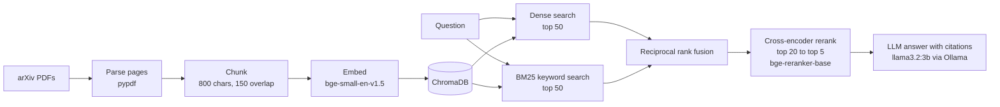

# RAG over arXiv Papers: Hybrid Retrieval, Reranking, and Honest Evaluation

A question-answering system over ~40 arXiv papers about retrieval-augmented generation. Every answer cites the paper and page it came from. The project is built from scratch (no LangChain or LlamaIndex) and **every retrieval change is measured on an evaluation set**, so the numbers below show what helped, what didn't, and what broke.

> **Headline result:** hybrid search (BM25 + embeddings) followed by a cross-encoder reranker raised **MRR from 0.724 to 0.900** and **recall@1 from 0.615 to 0.846** on my evaluation set, with no extra training. See [Results](#results) for the caveats.

<!-- TODO: add a demo GIF of `python src/ask.py` here -->

## Why this project

Most RAG demos look good on a handful of hand-picked questions and never measure anything. I wanted to answer a more useful question: *which components actually improve retrieval, by how much, and where does the system still fail?* So the evaluation set and scoring script came before any tuning, and each experiment is one change compared against the previous setup.

## How it works



| Stage | Choice | Why |
|---|---|---|
| Parsing | `pypdf`, page by page | Keeps page numbers so answers can cite sources |
| Chunking | 800 characters, 150 overlap | Simple baseline; metadata (paper, page) stored per chunk |
| Embeddings | `BAAI/bge-small-en-v1.5` | Small, fast, runs on CPU |
| Vector store | ChromaDB (cosine) | Local and persistent, no server needed |
| Keyword search | `rank-bm25`, built in memory from the stored chunks | Catches exact strings that embeddings miss |
| Fusion | Reciprocal rank fusion (k=60) | Merges two rankings without tuning score scales |
| Reranker | `BAAI/bge-reranker-base` cross-encoder | Rescoring 20 candidates is much more accurate than first-pass search |
| Generator | `llama3.2:3b` through Ollama, using the OpenAI-compatible client | Free and local; swap models with environment variables |

## Results

Retrieval is scored on **39 answerable questions**. A hit means the correct paper and page appears in the top k results.

| Setup | recall@1 | recall@3 | recall@5 | recall@10 | MRR |
|---|---|---|---|---|---|
| Dense embeddings only (baseline) | 0.615 | 0.795 | 0.897 | 0.974 | 0.724 |
| + cross-encoder reranker | 0.821 | 0.949 | 0.949 | 0.949 | 0.876 |
| Hybrid (BM25 + dense) | 0.692 | 0.897 | 0.923 | 0.949 | 0.796 |
| **Hybrid + reranker** | **0.846** | **0.949** | **1.000** | **1.000** | **0.900** |

What I take from this:

- **The baseline usually finds the right page but ranks it low** (recall@10 is 0.974, recall@1 is 0.615). That gap is what the reranker closes.
- **The reranker is the biggest single gain.** recall@1 went from 24 to 32 of 39 questions.
- **Hybrid search fixed a failure the other setups never did.** A table-lookup question about the `selector-agent-trim` model on `ncsu-las` missed in every run until BM25 was added. Embeddings handle exact identifiers poorly, and BM25 matches them directly.
- **Combining them works best.** BM25 widens the candidate pool and the reranker sorts it.

### Read these numbers with caution

- **The evaluation set is small.** One question is worth about 2.6 percentage points, so differences of one or two questions are within noise.
- **I tuned against this set.** I removed flawed questions and chose experiments after looking at misses, so the final numbers are optimistic. The `1.000` is not a claim of perfect retrieval.
- **Most questions are synthetic.** About 30 were drafted by a local LLM from random chunks and then filtered by hand. They tend to reuse their source chunk's wording, which makes retrieval easier than real user questions would.
- **Gold labels are page-level.** If the same fact appears on several pages, a correct retrieval from another page counts as a miss.
- **A held-out set of hand-written questions is on the roadmap** to test the final setup once, without tuning.

### Generation (answer behavior)

On an earlier version of the question set (41 answerable, 9 unanswerable) with plain dense retrieval and the 3B model, the model refused to answer **22% of answerable questions** and correctly refused **89% of unanswerable ones**. Refusal rate is a crude proxy: it does not measure whether the non-refusals were correct or faithful.

<!-- TODO: rerun `python eval/run_eval.py --name gen_final --hybrid --rerank --generate` and update these numbers -->

## What failed, and what I learned

**1. Broad queries retrieve title pages and bibliographies.** "What is retrieval-augmented generation?" returned a title page and a reference entry at ranks 1 and 2, because short, keyword-dense chunks match the phrase without explaining anything. A more specific rewording ("noisy retrieved documents hurt answer quality") returned real content.

**2. Embedding distance is not a reliable confidence signal.** A vague query had tightly bunched, high distances (about 0.31), which looked like "no good match". But another query had very low distances (about 0.10) on bibliography entries that merely contained the topic phrase.

**3. Prompt templates inside the papers leaked into answers.** Asked "What is the capital of France?", the system answered `{"Reasoning": ..., "Response": "Paris"}`. One paper contains a few-shot prompt example about exactly that question, and the 3B model copied both the fact and the output format. Retrieved text is untrusted input: it can answer questions and also steer the model's behavior. I removed this question from the unanswerable set and added a prompt rule that passages are reference material, never instructions.

**4. A reranker score threshold cannot reliably detect off-topic questions.** Off-topic questions like "capital of the United States" scored 0.96 and "capital of France" 0.995, as high as genuinely answerable questions, because the corpus contains QA-shaped examples. A threshold catches clearly unrelated questions (recipe: 0.00, World Cup: 0.29) but not these.

**5. Naive junk filtering did not help.** I wrote heuristics to drop bibliography chunks, tiny fragments, and prompt templates (3,881 to 3,304 chunks). On the 41-question set at the time, recall@5 fell from 0.878 to 0.829. Inspecting the misses showed one affected question was itself drawn from a reference list (a flawed question), and another was likely noise from approximate nearest-neighbor search. I revised the heuristics but did not find a clear gain, so filtering is **off by default** (`USE_FILTERS=1` to enable). Note that the revised filter was not benchmarked separately.

**6. A 3B local model is conservative.** It refuses on a meaningful share of answerable questions and follows strict instructions imperfectly. Comparing it with a larger hosted model is on the roadmap.

## Quick start

Requires Python 3.10+ and [Ollama](https://ollama.com) for answer generation. Retrieval and evaluation work without it.

```bash
git clone https://github.com/<your-username>/<your-repo>.git
cd <your-repo>

python -m venv .venv
source .venv/bin/activate          # Windows: .venv\Scripts\activate
pip install -r requirements.txt

# 1. Download the corpus (arXiv papers on RAG into data/raw/)
python src/download_corpus.py

# 2. Chunk, embed, and index
python src/ingest.py

# 3. Ask questions (hybrid search + reranker + local LLM)
ollama pull llama3.2:3b
python src/ask.py
```

All scripts anchor their paths to the project root, so they work from any directory. The PDFs and the vector index are gitignored and rebuilt by the commands above.

**Using a hosted model instead of Ollama:** set `LLM_BASE_URL`, `LLM_API_KEY`, and `LLM_MODEL` in your environment. No code changes needed.

## Reproducing the evaluation

```bash
python eval/run_eval.py --name baseline                    # dense only
python eval/run_eval.py --name rerank --rerank             # + reranker
python eval/run_eval.py --name hybrid --hybrid             # BM25 + dense
python eval/run_eval.py --name hybrid_rerank --hybrid --rerank

# Answer behavior (slow on CPU, use --limit for a quick check)
python eval/run_eval.py --name gen --hybrid --rerank --generate --limit 10
```

Results are saved to `eval/results/<name>.json`, including the list of missed questions.

## Project structure

```
├── src/
│   ├── download_corpus.py   # fetch PDFs from arXiv
│   ├── ingest.py            # parse, chunk, embed, index (optional filters)
│   ├── retrieve.py          # dense, hybrid, and reranked retrieval
│   ├── generate.py          # grounded answers with citations
│   └── ask.py               # interactive question loop
├── eval/
│   ├── questions.jsonl      # evaluation questions with gold paper and page
│   ├── run_eval.py          # recall@k, MRR, refusal rates
│   ├── make_questions.py    # drafts questions from random chunks (needs manual review)
│   ├── check_questions.py   # validates the JSONL file
│   └── results/             # saved experiment outputs
├── data/raw/                # downloaded PDFs (gitignored)
├── chroma_db/               # vector index (gitignored)
└── requirements.txt
```

## Evaluation method

- **Gold labels:** each answerable question lists the paper and page that contain the answer.
- **recall@k:** fraction of questions where a gold page appears in the top k results.
- **MRR:** mean of 1/rank of the first gold page (0 if absent), which rewards ranking the right page higher.
- **Refusal rates:** with `--generate`, how often the model says "I don't know" on answerable questions (lower is better) and on unanswerable ones (higher is better).
- **Question sources:** a small hand-written set plus LLM-drafted questions that I reviewed and pruned. Questions drawn from reference lists, example passages, or vague context were removed.

## Limitations

- Small, partly synthetic evaluation set that I tuned against (see [caution](#read-these-numbers-with-caution)).
- Page-level gold labels, and many yes/no style synthetic questions.
- No answer-quality or faithfulness metric beyond refusal rates yet.
- Text-only PDF parsing: tables and two-column layouts can come out garbled.
- Local CPU inference is slow, especially for generation with the reranker.
- The corpus is not redistributed. Run the download script to rebuild it.

## Roadmap

- [ ] Held-out set of hand-written questions, scored once with the final setup
- [ ] Answer-quality evaluation (faithfulness and correctness, with manual spot checks)
- [ ] Compare the 3B local model against a larger hosted model
- [ ] Chunking experiments (size, overlap, sentence-aware splitting)
- [ ] FastAPI backend and a Streamlit or Gradio front end
- [ ] Dockerfile, tests, and CI

## Tech stack

Python, ChromaDB, sentence-transformers (`bge-small-en-v1.5`, `bge-reranker-base`), rank-bm25, pypdf, Ollama, the OpenAI Python client (as a generic chat client).